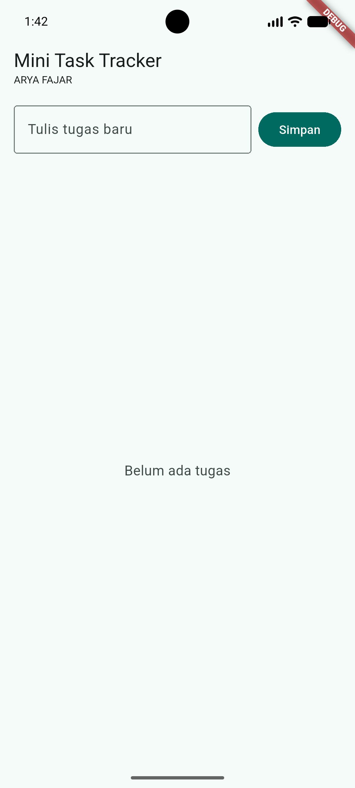
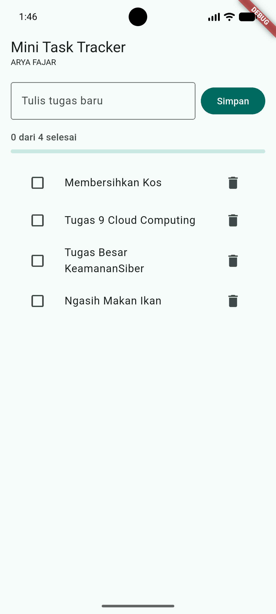
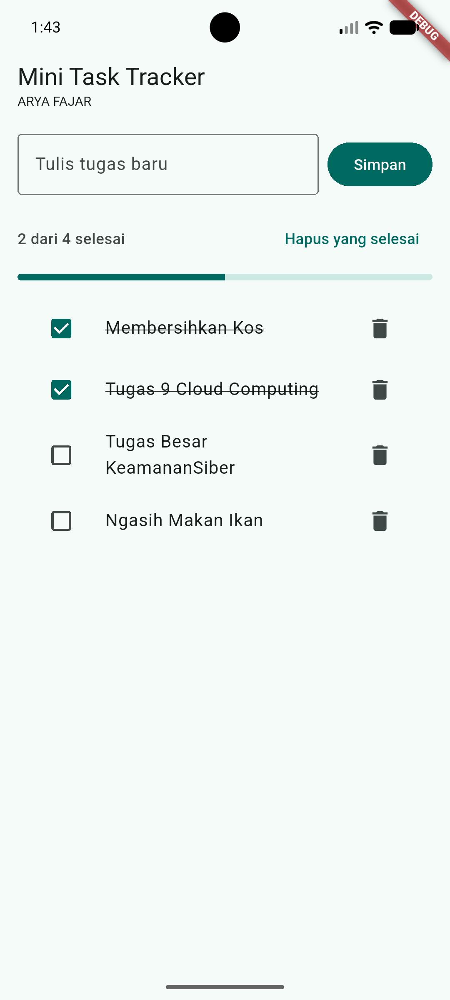
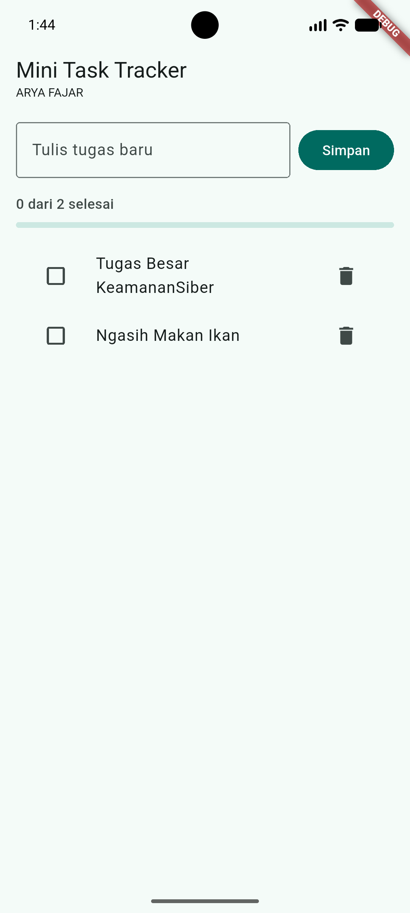

# Mini Task Tracker

Aplikasi Flutter satu halaman untuk mencatat daftar tugas harian. Dibuat sebagai
study case seleksi Motionlab.

## Identitas

- Nama: Arya Fajar
- NIM: 103012400125

## Screenshot

| Daftar kosong | Daftar berisi | Tugas selesai | Setelah hapus yang selesai |
|---|---|---|---|
|  |  |  |  |

## Fitur

- Menambah tugas lewat kolom teks, dengan tombol **Simpan** atau tombol Enter.
- Input kosong atau hanya spasi ditolak.
- Daftar tugas tampil di layar. Saat kosong, muncul teks "Belum ada tugas".
- Centang untuk menandai selesai (judul tercoret) dan ikon tong sampah untuk menghapus.
- Tambahan: penghitung progres ("2 dari 5 selesai") dengan progress bar, dan tombol "Hapus yang selesai" untuk membersihkan semua tugas yang tercentang sekaligus.
- Data disimpan di memori aplikasi dengan `setState`, jadi hilang saat aplikasi ditutup.

## Cara Menjalankan

Kebutuhan: Flutter 3.50 atau lebih baru (Dart SDK `^3.14.0`) dan emulator atau HP Android.

```bash
git clone https://github.com/AryaFajar200/MiniTaskTracker-Motion.git
cd MiniTaskTracker-Motion
flutter pub get
flutter run
```

Untuk membuat APK sendiri:

```bash
flutter build apk --release
```

Hasilnya ada di `build/app/outputs/flutter-apk/app-release.apk`.

## Struktur

Seluruh kode aplikasi ada di `lib/main.dart`:

- `Task`: model data (judul dan status selesai).
- `TaskPage` dan `_TaskPageState`: halaman utama, daftar tugas, dan logika tambah, centang, hapus.

### Deklarasi Penggunaan AI

- Apakah menggunakan AI? Ya
- Tool AI yang digunakan: Claude (Claude Code)
- Estimasi persentase kontribusi AI: sekitar 29% (Maksimal 40%). Dihitung dari 175 baris kode di `lib/main.dart` (tanpa baris kosong dan komentar): ±50 baris kerangka tampilan dari AI, ±17 baris boilerplate bawaan `flutter create` (`main()` dan `MyApp`), dan ±108 baris ditulis sendiri. Jika boilerplate bawaan dikeluarkan dari total, porsi AI sekitar 32%.
- Bagian kode/fitur yang dibantu AI:
  - Kerangka awal `lib/main.dart`: struktur `MaterialApp`, `Scaffold`, tata letak `Row`/`Column`, `TextField`, `FilledButton`, dan `ListView.builder` (tanpa logika).
  - Mengatasi error build NDK saat `flutter run` pertama kali (memasang NDK 28.2.13676358 secara manual).
  - Penyusunan draf README ini.
- Bagian yang dikerjakan sendiri: class `Task`, daftar tugas, fungsi `_addTask`, `_toggleTask`, `_deleteTask` beserta validasinya, penyambungan semuanya ke UI (`ListTile`, `Checkbox`, `onSubmitted`, `itemCount`), tampilan "Belum ada tugas" saat daftar kosong, penghitung progres ("2 dari 5 selesai") dengan progress bar, tombol "Hapus yang selesai", dan nama pada `AppBar`.
- Pernyataan:
  "Saya menyatakan bahwa saya memahami alur dan fungsi dari seluruh kode yang ada dalam repositori ini"
